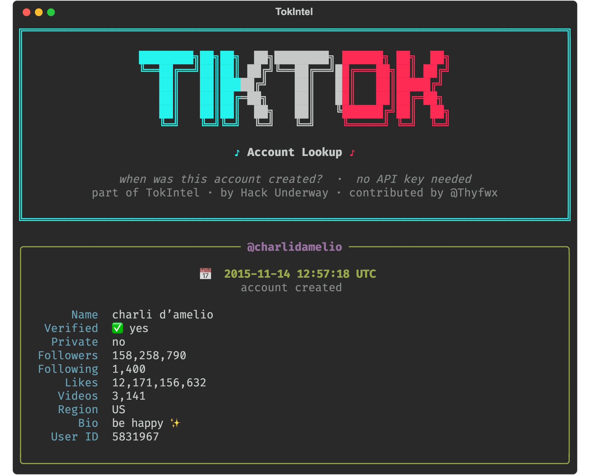

# TokIntel

TokIntel looks up a TikTok account from its username and tells you when it was created, with no API key and no signup.




## What it does

- Reads an account's creation date, followers, likes, bio, verified status and private status. Give it a username, an `@handle` or a profile URL.
- Reads the upload time of a video from its URL or id.
- Saves each run to `reports/` as JSON and TXT.
- Optional pivots (`--osint`): the bio link, links from the account's own Linktree, Beacons, Carrd or personal site, and other accounts whose page links back to this TikTok profile. A link back suggests the accounts are connected; it doesn't prove one person runs both. It also checks the same username on GitHub, YouTube, Snapchat, SoundCloud, Patreon, Tumblr, Roblox, Linktree, Behance, Last.fm, Chess.com, Pastebin and Flickr. Those matches are marked unverified, since another person can own the same handle. A match that also uses the same profile photo is marked a strong lead. A photo can be copied, so treat it as a place to look, not proof.
- Optional integrity flags (`--flags`): heuristic signs of bought followers, follow farms, fast growth and recent name changes. They're context, not accusations.

More screenshots: [account lookup](assets/account.png), [pivots](assets/pivots.png), [integrity flags](assets/flags.png), [a locked account](assets/locked.png).

## How it works

TikTok puts the account's `createTime` in the JSON on every public profile page, so one request to the profile is enough. Video ids are snowflakes, so a video's upload time comes from `id >> 32`. For public accounts there's no login and no third party API.

## Install and run

You need Python 3.11 or newer. Clone the repo, or download the ZIP from the Code button:

```sh
git clone https://github.com/Thyfwx/TokIntel.git
cd TokIntel
```

Then start the interface:

| System | How to start |
| --- | --- |
| macOS | Double click `TokIntel.app` or `TokIntel.command` |
| Windows | Double click `start.bat` |
| Linux or any terminal | Run `./start.sh` |

The first run builds a `venv` folder and installs the pinned packages from `requirements.txt`. If macOS blocks a double click after a ZIP download, right click `TokIntel.app`, choose Open, and confirm once.

For one lookup from the command line:

```sh
python3 tiktok_created.py charlidamelio
python3 tiktok_created.py @nasa https://www.tiktok.com/@zachking
python3 tiktok_created.py charlidamelio --all
```

`--osint` and `--flags` add the optional sections, and `--all` turns on both. `--file names.txt` reads one target per line. Install the packages yourself first if you run the script directly: `python3 -m pip install -r requirements.txt`.

## Accounts with audience controls

Some accounts use TikTok's audience controls, such as the 18 and older setting. TikTok won't show those profiles to anyone who isn't signed in, so a normal lookup returns nothing for them.

When that happens, the interface asks which browser you're signed in to TikTok on (chrome, firefox, edge, brave or safari) and reads the account with that login. The login is read on your computer for that one lookup. On the command line, set `TIKTOK_COOKIES_FROM_BROWSER=chrome` first, or put your `sessionid` value in a gitignored `tiktok_session.txt`. If `TIKTOK_COOKIE` or `TIKTOK_SESSIONID` is already set in your environment, that login is used first, even when you pick a browser.

## Limits

- It reads public profile pages only.
- Same username matches are leads, not identification.
- Use it only where the law and TikTok's terms allow. The tool is meant for research and learning.

## Credit and license

TokIntel is based on [TokIntel](https://github.com/HackUnderway/TokIntel) by Victor Bancayan (Hack Underway), which looks up emails and phone numbers through RapidAPI. This version does account lookups with no key. MIT licensed, see [LICENSE](LICENSE). Security reports go through [SECURITY.md](SECURITY.md).

Site: [thyfwxit.com](https://thyfwxit.com)
